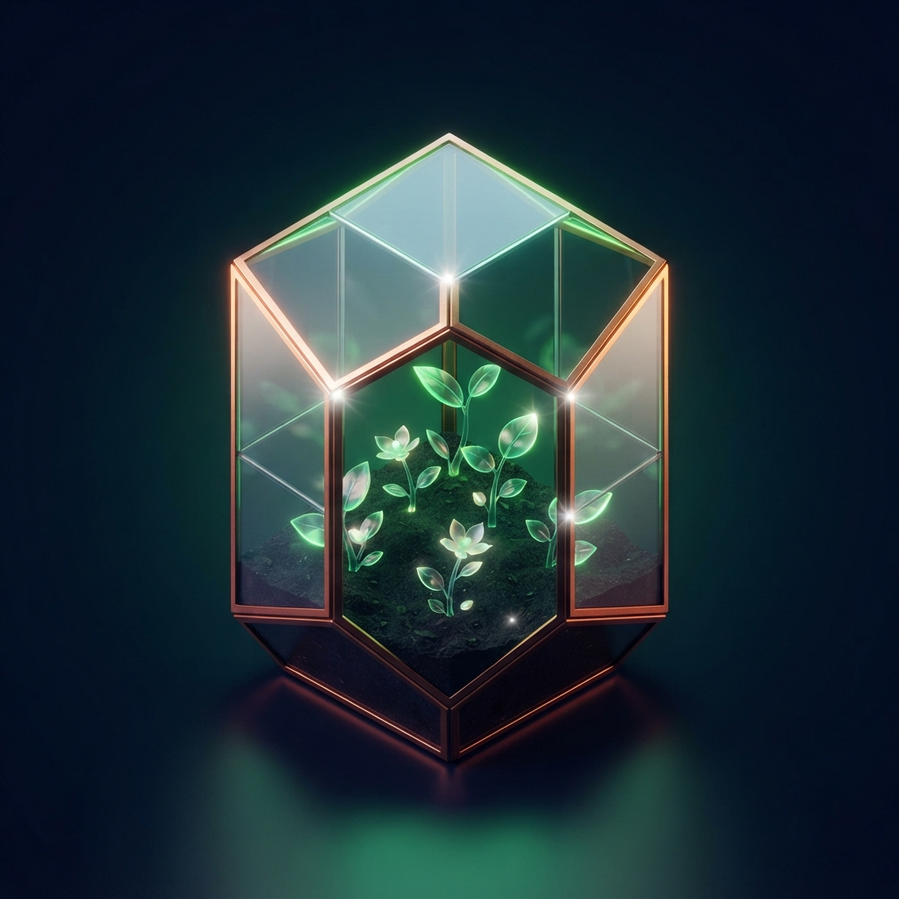
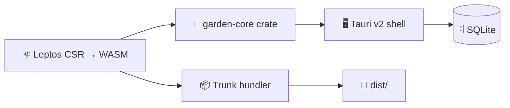

# Plonts - Rust/WASM Garden App

<p align="center">
  
</p>
> **Rust port of LovelyGarden**: a local-first gardening app built with
> **Leptos CSR**, compiled to WASM by Trunk, with a Tauri v2 desktop shell.
> Garden as a Reasoned Knowledge Graph — plants, seasons, climate as nodes. 🌿

[](https://github.com/shahriarhaqueabir/lovelygarden-rs/actions/workflows/build.yml)
[](https://www.rust-lang.org)
[](https://leptos.dev)
[](https://trunkrs.dev)
[](https://v2.tauri.app/)
[](#)

---

## Fun things you can do

- Plan your garden visually - drag plants onto a grid, see what fits
- Track seasons and get planting reminders based on your hemisphere
- Ask the AI coach about pests, soil, or companion planting

## 🎬 The story — why this exists

LovelyGarden started as a React/TypeScript web app. This is the Rust rewrite:
**Leptos CSR** compiled to WASM, with a **Tauri v2** desktop shell and a
`garden-core` crate shared between web and desktop. The goal: same gardening
knowledge graph, but memory-safe, portable, and offline-first with a tiny
binary. 🦀

> 💡 **The one sentence that drove everything:** _A garden is a reasoned
> knowledge graph — and Rust keeps it safe and fast._

---

## 🔁 The feedback loop (zero → finished)

```
  1. 🌱 INPUT      log a planting event or search the knowledgebase
  2. 🧠 PROCESS    reasoning engine evaluates the knowledge graph
  3. 🔍 SEARCH     search plant knowledgebase
  4. 📊 OUTPUT     updated garden grid, logbook entries
  5. 📓 AUDIT      persisted locally (SQLite in Tauri shell)
  6. 🔁 REPEAT     next season, next plant
```

---

## 🏗️ Architecture — how the pieces talk



| Component        | Responsibility                          | Key location   |
| ---------------- | --------------------------------------- | -------------- |
| 🦀 Frontend      | Leptos CSR compiled to WASM             | `src/`         |
| 🧠 Core          | Shared garden logic (reasoning, models) | `garden-core/` |
| 🖥️ Desktop shell | Tauri v2 native window                  | `src-tauri/`   |
| 📦 Bundler       | Trunk → WASM + assets                   | `Trunk.toml`   |
| 🎨 Styles        | Tailwind CSS                            | `styles/`      |

---

## 🏆 Good choices (and why they were good)

1. **🦀 Rust for memory safety.** No GC pauses, predictable performance for
   a desktop app.
2. **⚛️ Leptos CSR.** Reactive UI compiled to WASM — runs in browser or
   Tauri WebView.
3. **📦 Shared `garden-core` crate.** Same logic for web and desktop targets.
4. **🎯 `opt-level = "z"` + LTO.** Minimal WASM binary size.
5. **🖥️ Tauri v2 shell.** Native window, small binary, no Electron bloat.
6. **🔒 `console_error_panic_hook`.** Better debugging in WASM.

---

## 📋 The playbook — recreate from zero

### Phase 0 — Scope 🎯

1. One sentence: _"A garden is a reasoned knowledge graph."_
2. Boundaries: local-first, memory-safe, portable.

### Phase 1 — Skeleton 🦴

3. Cargo workspace: `lovelygarden`, `garden-core`, `src-tauri`.
4. Leptos 0.8 with CSR feature.
5. Trunk bundler config (`Trunk.toml`).

### Phase 2 — Core crate 🧠

6. Garden models (plants, seasons, climate).
7. Reasoning engine (companion compatibility, seasonal eligibility).
8. serde for (de)serialization.

### Phase 3 — Frontend ⚛️

9. Leptos components for garden grid, logbook.
10. web-sys for canvas (garden visualization).
11. wasm-bindgen-futures for async.

### Phase 4 — Desktop shell 🖥️

12. Tauri v2 integration.
13. SQLite via Tauri plugin or Rust crate.
14. Native window with WebView2.

### Phase 5 — Build & ship 🚢

15. `cargo build` for WASM.
16. `trunk build --release` for production bundle.
17. `cargo tauri build` for desktop binary.

---

## ⚠️ Mistakes to avoid

- 🚫 **Mixing Leptos versions.** Keep `leptos` and `leptos_router` in sync.
- 🚫 **Forgetting `wasm-bindgen` features.** Canvas, events need explicit
  feature flags in `web-sys`.
- 🚫 **Large WASM binaries.** Use `opt-level = "z"` + LTO + codegen-units = 1.
- 🚫 **Tauri v1 vs v2.** APIs differ; stick to v2.
- 🚫 **No panic hook in WASM.** Always include `console_error_panic_hook`.

---

## 🧰 Stack

| Layer            | Technology                    | Why                         |
| ---------------- | ----------------------------- | --------------------------- |
| 🦀 Language      | Rust 2021 edition             | Memory safety, performance  |
| ⚛️ Frontend      | Leptos 0.8 (CSR)              | Reactive UI → WASM          |
| 📦 Bundler       | Trunk                         | WASM build + asset pipeline |
| 🖥️ Desktop       | Tauri v2                      | Native window, small binary |
| 🎨 Styling       | Tailwind CSS 3.4              | Utility-first               |
| 📦 Serialization | serde + serde_json            | Data exchange               |
| 🌐 WASM glue     | wasm-bindgen, js-sys, web-sys | JS interop                  |
| 🧪 Tests         | cargo test (workspace)        | Rust-native                 |

## 🚀 Quick start

```bash
# Install Trunk
cargo install trunk

# Build CSS
pnpm css:build

# Dev (web)
trunk serve

# Build (release)
pnpm build

# Desktop (Tauri)
cd src-tauri && cargo tauri dev

# Tests
cargo test --workspace
```

## 📸 Screenshots

| View 1 | View 2 | View 3 |
|---|---|---|
|  |  |  |

> Add your own screenshots under docs/screenshots/.

## 📌 TL;DR

- **Problem:** JS garden app lacking memory safety and portability.
- **Solution:** Rust/Leptos CSR compiled to WASM with a shared garden-core crate and Tauri v2 shell.
- **Why it is interesting:** shows a Rust rewrite of a web app with shared core logic across web and desktop targets.


## 📜 License

See repository for license details.
